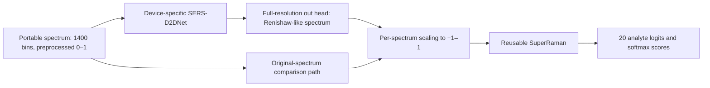

# SERS-D2DNet + SuperRaman

**Cross-device SERS standardization and 20-analyte classification**

[](LICENSE)
[](CHANGELOG.md)

This repository provides the primary two-stage workflow accompanying **Deep learning-based cross-device standardization of surface-enhanced Raman spectroscopy for enhanced bacterial recognition**, by Sakib Mahmud and colleagues, *Spectrochimica Acta Part A* **347** (2026), 126931. [Read the paper](https://doi.org/10.1016/j.saa.2025.126931).

Start with **[00_control_center.ipynb](notebooks/00_control_center.ipynb)**. The notebooks are the main interface: they share one configuration and persistent run, prepare data, train the models independently, connect their checkpoints, and display before/after results. The same operations are available through a Python API and CLI.

> **Scientific scope.** The recovered primary implementations and data interfaces are technically verified. Exact published-result reproduction is not established. The recovered translator has **61,511,562 parameters**, versus the paper's reported **6.15 million**; pooling/interpolation, classifier loss/shifts, and data selection also have documented differences. Original paper-trained weights are unavailable. See the [paper alignment map](docs/PAPER_IMPLEMENTATION_MAP.md) before interpreting results.

## How the two stages connect

Four device-specific **SERS-D2DNet** models map Enwave, Tec5, Fdefender, and RID spectra into the Renishaw reference domain. One **SuperRaman** classifier learns the 20-analyte label space from Renishaw spectra. These models train independently; a portable bundle connects them for inference.



The runner saves both classification paths in the original sample order. Translator outputs are linear and remain unclipped. Renishaw inputs bypass translation. TensorFlow and PyTorch execute in separate workers, with independently selected devices. Softmax scores are uncalibrated; these analyte predictions do not establish clinical diagnostic efficacy.

## Install and open the control center

Use **Python 3.11–3.13** in a dedicated environment. WSL/Linux is the verified development platform.

```bash
python -m venv .venv
source .venv/bin/activate
python -m pip install --upgrade pip
python -m pip install -e ".[notebooks]"
python -m jupyter lab notebooks/00_control_center.ipynb
```

For VS Code, open the repository, open the control center, and select this environment as the notebook kernel. If you already have the required frameworks, install with `python -m pip install --no-deps -e .` in a separate environment inheriting those packages. On Windows, activation uses `.venv\Scripts\Activate.ps1`; TensorFlow GPU execution requires its own supported platform/runtime. No notebook installs or upgrades packages automatically.

TensorFlow **2.21.0** and PyTorch **2.6.0** are the verified framework versions. The package base imports neither backend. Stage-only installations use `.[translation]` or `.[classification]`; notebook use requires `.[notebooks]`.

## Notebook frontend

| Notebook | Role |
|---|---|
| [00 — Control center](notebooks/00_control_center.ipynb) | Operate the complete workflow and inspect validation/results |
| [01 — Data](notebooks/01_data_contract.ipynb) | Prepare roles, inspect metadata, verify all 20 classes |
| [02 — Translation](notebooks/02_train_translation.ipynb) | Train and inspect selected device-specific translators |
| [03 — Classification](notebooks/03_train_classifier.ipynb) | Train and inspect the reusable Renishaw classifier |
| [04 — Cascade](notebooks/04_translate_and_classify.ipynb) | Build a bundle and evaluate original/translated held-out rows |
| [05 — Explanations](notebooks/05_explain_predictions.ipynb) | Inspect fixed-target gradients and SmoothGrad |

The default [demo configuration](configs/workflow_demo.json) generates synthetic data, trains for one epoch, and uses width-2 translators on CPU. **Run All** in the control center completes this bounded software demonstration across all four portable devices. Saved outputs are synthetic. Demo scores and explanations have no scientific performance interpretation.

For a real experiment, copy [workflow_research.json](configs/workflow_research.json) to `configs/local/my_run.json`, set either `prepared_data` or `dataset`, and choose a new `run_directory`. Select that file in the notebook's `CONFIG` control. Review all settings, then set `RUN_RESEARCH_TRAINING = True` to launch research training. See the [notebook guide](docs/NOTEBOOK_GUIDE.md).

## Data and selection protocol

Input consists of preprocessed spectra, not raw detector output: float32 **`[N,1400]`**, intensities in **`[0,1]`**, source-device identity, and unique sample IDs. Labels use the fixed paper order; optional fields carry a physical Raman axis and acquisition groups. The loader accepts the original five-device HDF5 schema or canonical pickle-free NPZ batches. [Data contract and access](docs/DATA.md).

Research data and trained weights are not distributed. The original dataset contains **29,545 spectra** and 20 analyte classes, including biomarkers, LPS classes, and reference compounds. This is not a 20-bacterial-species diagnostic classifier.

The maintained protocol reserves independent fit, validation, and test roles. Exact duplicate spectra and supplied acquisition groups remain together. Translators use independent same-analyte source/reference pseudo-pairs; the classifier fits Renishaw only. Checkpoint selection uses validation only. Actual translator fit counts are recorded: reserving independent roles can leave fewer than the paper's 50 samples per class. Biological independence requires specimen/acquisition metadata that are absent from the inspected HDF5.

The paper reports polynomial baseline correction, three-bin smoothing, and a nominal 400–1800 cm⁻¹ crop. Its exact baseline settings, resampling, and endpoint convention are not recovered. The package therefore accepts already-preprocessed arrays and displays bin indices when no verified physical axis is supplied.

## Python and terminal interfaces

The notebooks use this backend-free controller:

```python
from sersd2d_superraman.workflow import Workflow

run = Workflow(".", "configs/workflow_demo.json")
run.prepare()
run.train_translations()
run.train_classifier()
run.build_bundle()
results = run.evaluate()
```

Completed stages can be reopened from another notebook. Reuse checks artifact hashes and input/configuration identities; it does not resume optimizer state. A changed configuration, damaged artifact, or failed/interrupted stage requires a new run directory.

For direct CLI use:

```bash
sers-pipeline prepare --dataset /authorized/SERS_D2DNet_Dataset.h5 --output data/prepared
sers-pipeline train-translation --data data/prepared --source Enwave \
  --config configs/maintained/translation.json --device cpu --output output/enwave
sers-pipeline train-classifier --data data/prepared \
  --config configs/maintained/classifier.json --device cpu --output output/classifier
```

Repeat translation training for each portable device. A complete bundle combines all four translators and one classifier:

```bash
sers-pipeline bundle --classifier output/classifier/checkpoint \
  --translator Enwave=output/enwave/checkpoint --translator Tec5=output/tec5/checkpoint \
  --translator Fdefender=output/fdefender/checkpoint --translator RID=output/rid/checkpoint \
  --output output/model_bundle
sers-pipeline predict --bundle output/model_bundle/bundle.json \
  --input data/prepared/Enwave/test.npz --device cpu --translation-device cpu \
  --output output/enwave_test
```

Use `--allow-partial` for a bundle supporting selected devices. Training/inference refuse to overwrite existing runs or single-output artifacts. `sers-pipeline --help` lists data inspection, separate inference, metrics, trusted legacy classifier migration, explanation, and benchmark commands.

## Outputs and interpretation

| Artifact | Contents |
|---|---|
| `workflow.json` and configuration snapshots | Controls, stage status, input/output identities |
| `prepared/<device>/` | Train/validation/test batches and split manifest |
| `translation/<device>/checkpoint/` | Weights, graph contract, actual fit counts, selected epoch |
| `classification/checkpoint/` | Tensor state dictionary, preprocessing, label order, provenance |
| `bundle/` | Copied checkpoints and relative-path manifest |
| `evaluation/<device>/` | Translations, both prediction paths, confusion matrices, spectral metrics |
| `evaluation_summary.json` | Combined comparison for the selected devices |

Classification reports overall accuracy and class-support-weighted precision, recall, F1, and specificity. Translation reports per-analyte and macro-class MAE, RMSE, PCC, R², cosine similarity, and continuous-overlap Dice against Renishaw class means. Negative R² is retained; undefined correlations remain missing. [Metric and model boundaries](docs/MODEL_CARDS.md).

## Verification and maintenance

```bash
python -m pip install -e ".[notebooks,dev]"
python -m ruff check src tests tools
python -m pytest -q
python tools/validate_notebooks.py
python -m build
python -m twine check --strict dist/*.whl dist/*.tar.gz
python tools/release_contents.py
```

[Verification evidence](docs/VERIFICATION.json) · [Second-pass review](docs/SECOND_PASS_REVIEW.md) · [Implementation status](docs/IMPLEMENTATION_STATUS.md) · [Benchmark protocol](docs/BENCHMARKS.md) · [Reproducibility and migration](docs/REPRODUCIBILITY.md).

The active repository contains the primary workflow, reusable tooling, tests, notebooks, and documentation. One-time local audit scripts, duplicate original trees, old environments/artifacts, and inactive translator builders were moved to a recoverable directory outside the checkout. Data, environments, checkpoints, and temporary outputs remain excluded from Git. No publication or remote CI success is implied by local verification.

## Citation and credits

```bibtex
@article{mahmud2026sers,
  title = {Deep learning-based cross-device standardization of surface-enhanced Raman spectroscopy for enhanced bacterial recognition},
  author = {Mahmud, Sakib and Sayem, Faizul Rakib and Hassan, Manal and Yang, Yanjun and Chowdhury, Muhammad E. H. and Zughaier, Susu M. and Bensaali, Faycal and Zhao, Yiping},
  journal = {Spectrochimica Acta Part A: Molecular and Biomolecular Spectroscopy},
  volume = {347}, pages = {126931}, year = {2026},
  doi = {10.1016/j.saa.2025.126931}
}
```

Use [CITATION.cff](CITATION.cff), cite the underlying method papers in [NOTICE.md](NOTICE.md), and record the software version, configuration, and checkpoint hashes used in your experiment. Code is provided under [MIT](LICENSE); data, weights, and the paper's license have separate scopes.
