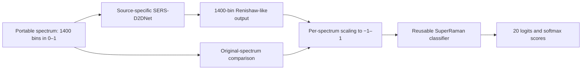

# SERS-D2DNet + SuperRaman

**Cross-device SERS standardization followed by 20-analyte classification**

[](LICENSE)
[](https://zenodo.org/records/23372983)
[](CHANGELOG.md)

Research software accompanying **Deep learning-based cross-device standardization of surface-enhanced Raman spectroscopy for enhanced bacterial recognition**, Sakib Mahmud and colleagues, *Spectrochimica Acta Part A: Molecular and Biomolecular Spectroscopy* **347** (2026), 126931. [Paper and DOI](https://doi.org/10.1016/j.saa.2025.126931).

**Start with [00_control_center.ipynb](notebooks/00_control_center.ipynb).** It is the main interface for preparing data, training both model stages, assembling a portable bundle, and comparing predictions before and after translation. Five focused notebooks share the same configuration and artifacts. Python and CLI interfaces expose the same operations.

> **Reproduction status:** the recovered implementations are available, but exact published-result reproduction is unresolved. In particular, the supplied translator has **61,511,562 parameters**, versus the paper's **6.15 million**. Pooling/interpolation, classifier loss/shifts, and selection protocols also have documented differences. Paper-trained weights are unavailable. Read the [paper alignment map](docs/PAPER_IMPLEMENTATION_MAP.md) before reporting research results.

## Quick start

Use **Python 3.11–3.13**. WSL/Linux is the historically verified development platform. The following installs the CPU demonstration environment into its own virtual environment:

```bash
git clone https://github.com/Sakib1263/SERS-D2DNet-SuperRaman.git
cd SERS-D2DNet-SuperRaman
python -m venv .venv
source .venv/bin/activate
python -m pip install --upgrade pip
python -m pip install torch==2.6.0 --index-url https://download.pytorch.org/whl/cpu
python -m pip install -e ".[notebooks]" -c configs/constraints-cpu.txt
python -m sersd2d_superraman doctor
python -m jupyter lab notebooks/00_control_center.ipynb
```

In VS Code, select `.venv` as the notebook kernel. On native Windows, replace the activation line with `.venv\Scripts\Activate.ps1`. In WSL, use Linux paths such as `/mnt/c/...`, including in configuration files. No notebook installs packages automatically.

Leave `CONFIG = "configs/workflow_demo.json"` and choose **Run All**. The demo generates synthetic data, trains four width-2 translators and one classifier for one epoch on CPU, creates a bundle, and evaluates 20 held-out synthetic rows per portable device. Results appear below the controls and under `output/notebooks/demo/`. Demo scores have no scientific performance interpretation. Notebook outputs are cleared in Git so a new run starts with your own visible results.

The constraints file selects TensorFlow **2.21.0** and PyTorch **2.6.0**. It is not a complete dependency lock or a GPU environment specification. To preserve an existing GPU environment, use a separate environment inheriting its packages and install the project with `--no-deps`; see [reproducibility](docs/REPRODUCIBILITY.md). For stage-only use, install `.[translation]` or `.[classification]`. The base package imports neither framework. `doctor` reads installed package metadata; it does not initialize GPUs or certify binary compatibility.

## Dataset and access

The **[Multi-Instrument SERS Dataset](https://zenodo.org/records/23372983)** is archived on Zenodo as version **1.0.0**, DOI **[10.5281/zenodo.23372983](https://doi.org/10.5281/zenodo.23372983)**. It contains 29,545 SERS spectra across five instruments and 20 analyte classes. **The record is public; access to its files is restricted.**

Access is available following curator review of a reasonable request. Open the Zenodo record, sign in, and request access with a brief explanation of the intended use and your affiliation, if applicable. After approval, download the files and extract any archive locally. Research files are not included in this Git repository; the synthetic quick start works without dataset access.

To use the downloaded data, copy `configs/workflow_research.json` to `configs/local/my_run.json` and choose **one** input setting:

| Local input | Configuration |
|---|---|
| Downloaded preprocessed HDF5 file | Replace `prepared_data` with `"dataset": "data/private/<downloaded-file>.h5"` using the actual filename |
| Five canonical device NPZ files | Replace `prepared_data` with `"dataset": "data/private/canonical"` |
| Existing prepared split study | Keep `"prepared_data": "data/prepared"` |

Paths are relative to the repository root unless absolute. Use a fresh `run_directory`, select your local configuration in the notebooks, and review the controls before enabling research training. Keep downloaded data under ignored `data/` or outside the checkout. Run `sers-pipeline dataset-info` for access guidance from the terminal. [Complete data and preparation guide](docs/DATA.md).

The Zenodo record lists **CC BY 4.0** for the dataset; file access remains subject to curator approval. The software uses the separate [MIT license](LICENSE). Cite the dataset DOI and the associated paper when using the data. Trained paper weights are not supplied with this software.

## How the pipeline works

Portable instruments can produce different spectral responses for the same analyte. Four device-specific **SERS-D2DNet** translators learn Enwave/Tec5/Fdefender/RID → Renishaw mappings. A single **SuperRaman** classifier learns the fixed 20-analyte label space from Renishaw. Both stages train independently; their saved checkpoints connect at inference.



**Translator.** The recovered 1D encoder/decoder combines features at several resolutions and uses deep supervision: full-resolution `out` plus three lower-resolution heads at the default depth. Training minimizes a weighted MAE; inference uses only `out`. Its lineage includes [MLMRS-Net](https://doi.org/10.1007/s00521-022-08111-6), [UNet 3+](https://doi.org/10.1109/ICASSP40776.2020.9053405), and [pyramid spatial pooling](https://doi.org/10.1109/CVPR.2017.660). Code-specific differences from their descriptions are preserved in the alignment map.

**Classifier.** Generative neurons learn polynomial nodal responses, conceptually `sum(w_q * x**q)`, rather than only linear responses. Super neurons add kernel-location shifts. SuperRaman uses four operational branches, cubic expansion by default, pooling, and a 20-logit output. The maintained primary profile preserves the supplied fractional sampling behavior. See [Self-ONNs](https://doi.org/10.1016/j.neunet.2021.02.028) and [Super Neurons](https://doi.org/10.1109/TETCI.2023.3314658).

**Handoff.** Translator outputs remain linear and unclipped. Each spectrum is then scaled independently to `[-1,1]` for classification. The original-spectrum comparison uses the same scaling and classifier. Sample order and identities are retained; Renishaw inputs bypass translation. TensorFlow and PyTorch run in separate workers with independent device controls. Softmax scores are uncalibrated and do not establish clinical diagnostic efficacy.

## Notebook controls

| Notebook | Use |
|---|---|
| [00 — Control center](notebooks/00_control_center.ipynb) | Operate the entire workflow and inspect results |
| [01 — Data](notebooks/01_data_contract.ipynb) | Prepare and inspect independent roles and labels |
| [02 — Translation](notebooks/02_train_translation.ipynb) | Train selected source-to-Renishaw models |
| [03 — Classification](notebooks/03_train_classifier.ipynb) | Train the reusable Renishaw classifier |
| [04 — Cascade](notebooks/04_translate_and_classify.ipynb) | Bundle checkpoints and compare held-out predictions |
| [05 — Explanations](notebooks/05_explain_predictions.ipynb) | Inspect fixed-target gradients and SmoothGrad |

Select one JSON file with `CONFIG` in every notebook. `sources` chooses devices; `classifier_device` and `translation_device` select hardware separately. Completed stages are reused only when code, settings, inputs, and output hashes match. Worker logs are stored under the run's `logs/` directory. Reuse does not restore optimizer state. [Full notebook guide](docs/NOTEBOOK_GUIDE.md).

## Run a real experiment

1. [Request dataset access on Zenodo](https://zenodo.org/records/23372983), then download and extract the approved files as described in [Dataset and access](#dataset-and-access).
2. Copy [workflow_research.json](configs/workflow_research.json) to ignored `configs/local/my_run.json`. Set exactly one of `dataset` (original HDF5 or five-device NPZ directory) and `prepared_data` (an existing prepared study).
3. Set a new `run_directory`, review architecture/training settings, and select available hardware. Relative paths resolve from the repository root.
4. Set every notebook's `CONFIG` to that file. Run Setup and data preparation. Set `RUN_RESEARCH_TRAINING = True` explicitly to launch research training.
5. Inspect validation histories and actual fit counts, then evaluate held-out roles. Preserve configuration, checkpoint hashes, and run logs with your results.

Input spectra are finite float32 **`[N,1400]`** in **`[0,1]`**, with a source device and unique sample IDs. Labels follow the fixed paper order; optional fields provide a verified physical Raman axis and acquisition groups. The original dataset has **29,545 spectra in 20 analyte classes**, including biomarkers, LPS classes, and reference compounds. This is not a 20-bacterial-species classifier. [Data format and access](docs/DATA.md).

The maintained protocol reserves independent fit, validation, and test roles; duplicate spectra and supplied acquisition groups stay together. Translators use same-analyte, physically unpaired source/reference pseudo-pairs, requesting at most 50 fit pairs per class. Actual counts are recorded. The classifier fits Renishaw only and selects checkpoints on Renishaw validation. Specimen-level independence cannot be established from missing acquisition metadata.

The paper describes polynomial baseline correction, three-bin smoothing, and a nominal 400–1800 cm⁻¹ crop. Exact baseline parameters, resampling boundaries, and endpoint convention were not recovered. This package therefore accepts already-preprocessed spectra and uses bin indices when no verified physical axis is supplied.

## Python and CLI alternatives

```python
from sersd2d_superraman.workflow import Workflow

run = Workflow(".", "configs/workflow_demo.json")
run.prepare()
run.train_translations()
run.train_classifier()
run.build_bundle()
results = run.evaluate()
```

For the same workflow from a terminal, run `python examples/run_workflow.py --config configs/workflow_demo.json`. Choosing a research configuration in this script starts research training directly; the notebook training switch applies only to notebooks.

Individual stages are also available:

```bash
sers-pipeline prepare --dataset /authorized/SERS_D2DNet_Dataset.h5 --output data/prepared
sers-pipeline train-translation --data data/prepared --source Enwave \
  --config configs/maintained/translation.json --device cpu --output output/enwave
sers-pipeline train-classifier --data data/prepared \
  --config configs/maintained/classifier.json --device cpu --output output/classifier
```

Repeat translation training for the other source devices. A complete inference bundle contains all four translators and the classifier:

```bash
sers-pipeline bundle --classifier output/classifier/checkpoint \
  --translator Enwave=output/enwave/checkpoint --translator Tec5=output/tec5/checkpoint \
  --translator Fdefender=output/fdefender/checkpoint --translator RID=output/rid/checkpoint \
  --output output/model_bundle
sers-pipeline predict --bundle output/model_bundle/bundle.json \
  --input data/prepared/Enwave/test.npz --device cpu --translation-device cpu \
  --output output/enwave_test
```

Use `--allow-partial` for selected-device bundles. `sers-pipeline --help` lists inspection, metrics, migration, explanation, and benchmark commands. A single-output command creates a new artifact; training and cascade commands require an empty output directory.

## Outputs and troubleshooting

| Location in a workflow run | Contents |
|---|---|
| `workflow.json`, `*_config.json`, `logs/` | Controls, stage status, identities, worker logs |
| `prepared/<device>/` | Fit/validation/test NPZ batches and split manifest |
| `translation/<device>/`, `classification/` | Validation histories, selected checkpoint, provenance |
| `bundle/` | Copied checkpoints and relative-path manifest |
| `evaluation/<device>/` | Translations, both prediction paths, classification and spectral metrics |
| `evaluation_summary.json` | Comparison across the selected devices |

Classification reports overall accuracy and support-weighted precision, recall, F1, and specificity. Translation metrics compare independent analyte means with Renishaw means, using per-class and macro MAE, RMSE, PCC, R², cosine similarity, and continuous-overlap Dice. Negative R² remains negative; undefined correlations remain missing. [Model and metric boundaries](docs/MODEL_CARDS.md).

| Symptom | Action |
|---|---|
| Dataset missing or prepared study not found | Run `sers-pipeline dataset-info`, request access, then configure the downloaded file or prepared split directory |
| Missing framework or wrong notebook kernel | Run `doctor` in the selected interpreter; install the appropriate extra there |
| TensorFlow cannot access a GPU | Set `translation_device` to `cpu`; PyTorch can still use its own working CUDA runtime |
| Output already exists | Reopen a completed workflow, or choose a fresh output path for a new experiment |
| Failed/interrupted stage or stale lock | Inspect its log and `workflow.json`; fix the cause and select a new run directory |
| Code, configuration, or an artifact changed | Start a new run; existing results are preserved rather than silently reused |

Checkpoint weights use content-addressed filenames; **read `metadata.json["weights"]`**, rather than guessing a filename. Serialization failures preserve the previous committed checkpoint. These are single-writer directories: copy a bundle for inference while another experiment trains. Power-loss durability and native Windows process-tree cancellation have not been certified. [Artifact and recovery details](docs/REPRODUCIBILITY.md).

## Repository and maintenance

`notebooks/` is the frontend; `configs/` holds profiles; `src/` implements the reusable stages; `docs/` records scientific contracts and operating instructions; `tests/` retains meaningful regressions; `tools/` contains reusable maintainer utilities. Data, checkpoints, environments, and generated outputs are excluded from Git.

Version 0.3.1 adds 13 passing offline dataset-access checks; see [implementation status](docs/IMPLEMENTATION_STATUS.md#dataset-access-update-version-031). The version-0.3.0 review ran only new failure, cancellation, cache-identity, and efficiency checks. Earlier model parity, notebook execution, hardware, dataset, and installed-wheel tests were **not repeated**. [Third-pass review](docs/THIRD_PASS_REVIEW.md) · [Version-0.3.0 evidence](docs/THIRD_PASS_VERIFICATION.json) · [Historical second-pass evidence](docs/VERIFICATION.json). No full research training or published-score reproduction is claimed. See [CONTRIBUTING.md](CONTRIBUTING.md) for future checks and release preparation.

## Citation and credits

```bibtex
@article{mahmud2026sers,
  title = {Deep learning-based cross-device standardization of surface-enhanced Raman spectroscopy for enhanced bacterial recognition},
  author = {Mahmud, Sakib and Sayem, Faizul Rakib and Hassan, Manal and Yang, Yanjun and Chowdhury, Muhammad E. H. and Zughaier, Susu M. and Bensaali, Faycal and Zhao, Yiping},
  journal = {Spectrochimica Acta Part A: Molecular and Biomolecular Spectroscopy},
  volume = {347}, pages = {126931}, year = {2026},
  doi = {10.1016/j.saa.2025.126931}
}
```

Dataset citation:

```bibtex
@dataset{mahmud2026sersdataset,
  author = {Mahmud, Sakib},
  title = {Multi-Instrument SERS Dataset},
  year = {2026}, version = {1.0.0}, publisher = {Zenodo},
  doi = {10.5281/zenodo.23372983},
  url = {https://zenodo.org/records/23372983}
}
```

Use [CITATION.cff](CITATION.cff), cite the dataset and the relevant [method papers](docs/REFERENCES.md), and report the software version, configuration, and checkpoint hashes. [NOTICE.md](NOTICE.md) documents implementation lineage and credits. Code is under [MIT](LICENSE); the dataset, weights, and article have separate license scopes.
